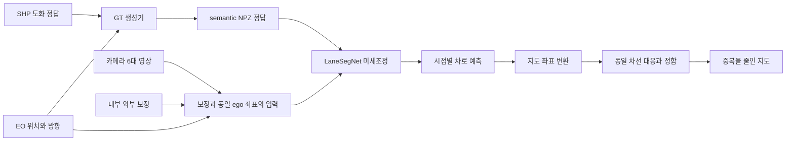

# GG49 LaneSegNet 학습과 시점 간 차선 정합 PRD

작성일: 2026-10-24 (Asia/Seoul) · v0.3 · 영상 비교 실험·RGB+LiDAR 목표·mms 환경·24 epoch 자동 학습과 대시보드 반영

## 1. 우리가 하려는 일

차량이 이동하면서 촬영한 여러 카메라 영상으로 도로의 차로 중심선과 좌우 경계를 예측한다. 서로 다른 위치에서 같은 도로를 예측하면 선의 위치와 모양이 조금씩 달라져, 전체 지도에 겹쳤을 때 한 차선이 여러 선으로 보인다. 최종 목표는 이 관측들을 공통 지도 좌표에 놓고 동일 차선을 연결·정합·중복 제거하여 일관된 지도로 만드는 것이다.

이번 첫 목표는 **한국 도로 데이터로 LaneSegNet을 실제로 미세조정하고, 검증 결과와 실패 원인을 재현 가능하게 남기는 것**이다. 이후 그 모델의 여러 시점 예측을 이용해 지도 정합 알고리즘을 개발한다. 학습이 끝났다고 시점 간 정합까지 자동으로 해결되는 것은 아니다.

대화에서 멘토가 말한 “캘리브레이션”은 이 문맥에서는 시점 간 지도 정합·융합을 포함한다. 카메라 자체의 내부·외부 보정값을 새로 추정하는 작업과 구분한다. 먼저 기존 보정과 pose가 맞는지 검사하고, 이후 남는 예측의 중복·오차를 처리한다.

첨부 대화와 사진은 요구 배경이다. 과거 명령·경로·실험값은 현재 컴퓨터에서 검증한 뒤 적용한다. 사진만으로 오차 크기나 원인을 확정하지 않는다.

## 2. 용어와 역할

| 용어           | 여기서의 의미                                                                                 |
| -------------- | --------------------------------------------------------------------------------------------- |
| LaneSegNet     | 영상 특징을 BEV로 모아 차로의 형상·경계 종류·차로 간 연결을 예측하는 전체 모델                |
| ResNet50 / R50 | 전체 모델 안에서 영상 특징을 뽑는 backbone. 파라미터 수를 줄이는 것이 이번 학습의 목적은 아님 |
| 초기 가중치    | OpenLane-V2로 학습된 LaneSegNet의 출발점. 우리 데이터로 추가 학습할 수 있음                   |
| SHP            | 지도 도형과 속성이 들어 있는 정답 원천. 파일명만 같은 다른 지역 자료는 쓸 수 없음             |
| GT             | Ground Truth, 학습할 정답. 여기서는 SHP로부터 파생한 중심선·경계·마스크·종류·연결             |
| EO             | External Orientation. 영상 시점의 위치·회전·시각 정보                                         |
| BEV / ego      | 위에서 내려다본 표현 / 차량의 현재 위치를 기준으로 한 좌표                                    |
| Track          | 한 번의 주행 묶음. 같은 도로를 반복 주행한 Track끼리는 평가 데이터가 겹칠 수 있음             |
| epoch          | 선택한 학습 데이터 전체를 한 번 학습한 횟수                                                   |
| 후처리         | 모델 예측을 지도 좌표로 옮겨 같은 차선을 대응·정합·합치는 알고리즘                            |

`r50_8x1_24e_olv2_subset_A`의 r50은 backbone, 8x1은 공식 8 GPU × GPU당 1 sample 학습 설정, 24e는 24 epoch, 나머지는 OpenLane-V2 subset A이다. 8x1은 카메라 개수가 아니다. 우리 컴퓨터에 GPU 8대가 필요하다는 뜻도 아니다.

## 3. 로컬 조사 결과와 결정

### 3.1 폴더와 가중치

2026-10-24 경로 변경: 작업 폴더는 `mms_project/gg49-lanesegnet-lab_gs`로 이름과 위치를 변경했다. 멘토 GT 생성기와 공식 모델 소스도 `mms_project` 아래의 현재 위치를 기준으로 기록한다.

| 용도               | 경로                                                                                                              |
| ------------------ | ----------------------------------------------------------------------------------------------------------------- |
| 새 작업 공간       | `/home/rjstns23/personal/mms_project/gg49-lanesegnet-lab_gs`                                                      |
| 멘토 GT 생성기     | `/home/rjstns23/personal/mms_project/gg49-lanesegnet-gt-builder`                                                  |
| 공식 모델 소스     | `/home/rjstns23/personal/mms_project/LaneSegNet`                                                                  |
| 원시 데이터        | `D:\2026-APR-01_GG803SEC012`                                                                                      |
| 정답 원천          | `D:\SHP데이터\통합SHP`                                                                                            |
| 복사한 초기 가중치 | `/home/rjstns23/personal/mms_project/gg49-lanesegnet-lab_gs/checkpoints/lanesegnet_r50_8x1_24e_olv2_subset_A.pth` |
| 기존 실험 참고     | `/home/rjstns23/personal/mms_project/hdmap-map/archive`                                                           |

초기 가중치 파일명은 멘토가 마지막에 지정한 것과 공식 Model Zoo의 R50 체크포인트 이름에 일치한다. 전달받은 파일은 182,203,523 bytes이고, CPU에서 `weights_only=True`로 읽었을 때 `meta`와 `state_dict`, 863개 state key가 확인되었다. `bev_constructor.cams_embeds`는 `(7,256)`이다. 복사 전후 SHA256은 아래와 같다. 이 해시는 복사본·전달 원본뿐 아니라 공식 Hugging Face 파일 페이지에 게시된 SHA256과도 일치한다. 공식 배포본과 바이트 내용이 일치하는 체크포인트로 확인했다.

`9a31e3b0890ff6d9b6128fb6b470a2cb5850789103e2c309e46d6c443b460cda`

원본 SHP·영상·LAS와 멘토 저장소를 편집하지 않는다. 가중치·캐시·실험 결과는 Git에 넣지 않고 경로·해시·설정·실험 요약을 관리한다. 멘토 저장소의 기존 untracked HTML 문서도 보존한다.

### 3.2 어떤 Track으로 시작하는가

멘토는 원하는 Track을 선택해도 된다고 답했다. **Track 이름보다 해당 영상·pose·보정·정답의 공간적 대응이 중요하다.** APR01 폴더만으로 첫 시도를 진행할 수 있으며, 모든 ZIP을 풀 필요는 없다.

| Track | 동기화된 시점 수 | RM1 선에서 10m 이내 | 57m 이내 | 첫 시도 판단     |
| ----- | ---------------: | ------------------: | -------: | ---------------- |
| A     |    EO/JPG 미추출 |              미확인 |   미확인 | 현재 사용 보류   |
| B     |              353 |                 341 |      351 | 첫 baseline 선택 |
| C     |              368 |                 341 |      349 | 후속 후보        |
| D     |              321 |                   0 |        0 | 현재 SHP로 보류  |
| E     |              317 |                   0 |        0 | 현재 SHP로 보류  |
| F     |              307 |                 269 |      280 | 후속 후보        |
| G     |               43 |                   0 |       12 | 현재 SHP로 보류  |
| H     |              306 |                 269 |      278 | 후속 후보        |

거리 통계는 카메라 6개 평균 XY와 RM1 선분의 최근접 거리이다. 근접성은 정답 존재의 사전 검사이며 유효 차로 GT 수를 보장하지 않는다. B~H는 카메라 1~6·Sphere의 행 수가 같고 timestamp 차이 0초이며 EO가 가리키는 영상 누락도 발견되지 않았다. 이는 실제 센서 clock drift나 rolling shutter 검증을 대신하지 않는다.

SHP는 RM1 3,183 도형, NT2 1,770 도형, PolyLineZ·UTM52N(EPSG:32652)이다. **`.cpg=UTF-8` 표기와 달리 RM1 일부 문자 필드는 CP949**이며, 실제 DBF 전 필드 검사를 근거로 이번 실행에 `--shp-encoding cp949`를 쓴다. 좌표계 라벨만 바꿔 재투영을 대신하지 않는다.

Scanfiles에는 LAS 32개, 약 18.78GB, 552,320,062 points가 있다. LAS의 존재만으로 모델의 LiDAR 입력이 준비된 것은 아니다. `D:\2026-APR-02_GG49`도 있지만 현재 최상위에 Track 영상 폴더가 없어 첫 입력으로 선택하지 않았다.

### 3.3 GPU와 실행 환경

RTX3060 12GB와 사용자 지정 WSL `mms`를 사용한다. 기존 Python3.12/PyTorch2.13-cu130 환경의 복구 사본은 D드라이브 tar로 보존했다. 현재 실제 동작 구성은 Python3.10.21/PyTorch1.13.1-cu117/MMCV-full1.7.0/MMDetection2.26.0/NumPy1.26.4이다. MMDet3D 전체의 오래된 데이터셋 의존성을 설치하는 대신, 공식 backbone/BEV/head를 보존하고 사용하는 camera detector 기반과 bbox coder 등록 경로만 로컬 adapter로 연결했다.

GT 생성도 현재는 mms를 사용한다. 과거 `.venv-gt`는 초기 소량 검증 기록이다. WSL `/mnt/d`에 D:를 연결했으며 원본 데이터는 읽기만 한다. 결과·캐시·checkpoint·백업은 `D:/mms_experiments/gg49-lanesegnet-lab_gs`에 저장한다. 코드와 mms 환경 자체는 기존 WSL 위치를 유지한다. `configs/storage.local.json`이 현재 경로의 기준이다.

실제 forward/backward·optimizer 검사를 통과한 공통 설정은384×384/micro batch2/gradient accumulation2(유효 batch4)이다. 검사에서 전체 GPU 사용량 약8.3GiB를 확인했다. CNN은 AMP를 사용하고 BEV/head/assignment/loss는 FP32로 유지한다. 메모리 예산은 전체10.5GiB이며 실제 학습 중에도 기록한다.

## 4. 데이터 흐름과 포함 범위

멘토 저장소는 `geometry → virtual → semantic`으로 GT를 만든다. **학습 엔진 전체가 포함된 저장소가 아니다.** `archive`의 입력·학습 코드 일부는 누락된 `v2_common.py`, `fusion_train.py`, 외부 engine에 의존한다. 과거 예제를 그대로 실행 가능한 학습기로 취급하지 않는다.

공식 LaneSegNet R50은 `use_lidar=False`인 영상 기반 모델이다. 영상 전용 모델은 데이터 연결·학습 동작과 성능 비교를 위한 첫 기준 실험이다. 목표 모델은 6대 카메라와 영상 시각 ±0.1초 LiDAR를 실제 결합한 모델이며, 두 모델을 각각 최대 24 epoch 학습한다. LiDAR는 pose·높이·지도 정합 검수와 후속 비교에 사용할 수 있다. 멘토의 RGB+LiDAR 모델 재현이 목표일 때에는 fusion 구조·학습 코드·체크포인트를 별도로 확보하거나 구현해야 한다. 영상 baseline의 결과를 RGB+LiDAR 재현이라고 보고하지 않는다.

이번 범위에서 backbone 교체·HPO·전 Track 압축 해제·대규모 장기 학습을 먼저 하지 않는다. 첫 실행의 데이터·GT·입력·loss를 검증한 뒤 범위를 넓힌다.

## 5. 입력과 정답 계약

### 필수 입력

1. 한 시점의 물리 카메라 1~6 영상과 고정된 카메라 순서.
2. 각 영상 및 Sphere EO의 동일 시점 대응. CSV는 filename;timestamp;XYZ;기타3개;row-major 회전9개.
3. Internal Orientation과 외부 pose. resize/crop/undistort와 같은 영상 변환을 K·투영행렬에도 일치 적용.
4. `RM1_LANELINE`, `NT2_LINK`와 `.shx/.dbf/.prj`. geometry와 semantic에 필요한 필드 존재·코드 의미 검사.
5. 실행한 원본 파일·버전·해시, 카메라 순서, 좌표축, 단위, 분할 정책.

Sphere는 GT 기준 pose에 쓰이지만 첫 baseline의 물리 카메라 6개 입력과 혼동하지 않는다. 멘토 archive에는 물리7+가상7의 14-view 입력 코드가 존재하므로 멘토 환경과 같다는 주장은 별도 비교 후에만 한다.

### 최종 GT

| 항목                     | shape / 의미                                         |
| ------------------------ | ---------------------------------------------------- |
| lanes                    | `(N,3,10,3)` = center/left/right × 10점 × XYZ, ego m |
| labels                   | `(N,)`, 차로 label                                   |
| masks                    | `(N,100,200)`, BEV 차로 영역                         |
| left_types / right_types | `(N,)`, unknown=-1 / none=0 / solid=1 / dashed=2     |
| adjacency                | `(N,N)`, 선행 차로 i → 후행 차로 j의 방향성 연결     |
| source_link_ids          | SHP 링크 추적 정보                                   |
| derived_virtual_flags    | 교차로 내부의 파생 가상 경계 여부                    |

Geometry 단계의 type=0은 placeholder이다. 최종 유형 학습에는 `semantic_topology_<hash>` 출력을 연결한다. unknown=-1을 none으로 바꾸지 않고 유형 loss에서 제외한다. 측량에 없는 교차로 가상 경계는 파생 GT로 표시하며 검수한다. Semantic 단계에서 인스턴스가 추가·재정렬될 수 있으므로 geometry NPZ의 행 번호와 같다고 가정하지 않는다. 최종 semantic NPZ 안의 lanes/masks/types/adjacency를 같은 인스턴스 순서로 읽는다.

GT의 origin/rotation과 정확히 같은 변환으로 입력·예측을 처리한다. 행벡터 규약은 `ego=(world-origin)@rotation`, `world=ego@rotation.T+origin`이다. GT ROI X±51.2/Y±25.6/Z[-4,2]를 선택하면 모델 encoder/head/decoder/assigner와 mask rasterizer의 범위·축·원점도 일치시킨다. 공식 mask 생성기의 기본 map_size는 X±50/Y±25이므로 조정하거나, NPZ mask를 직접 읽고 공식 변환으로 다시 덮어쓰지 않는다. 공식 초기 가중치의 Z 범위와 다르므로 명시한다.

`supervised_eligible=False` 또는 정답 범위 밖인 프레임은 unlabelled로 분리한다. 빈 NPZ만 보고 “차선 없음” negative로 학습하지 않는다. GT와 RGB overlay에서 축·좌우·진행 방향·Z 기준이 맞아야 한다.

## 6. 첫 학습 설정의 제안과 확인 조건

| 항목              | 제안 / 확인할 점                                                                                                                                                                 |
| ----------------- | -------------------------------------------------------------------------------------------------------------------------------------------------------------------------------- |
| 시작 모델         | R50 LaneSegNet, 전달 체크포인트의 호환 key에서 시작. 새 미세조정은 load_from 방식으로 가중치만 가져와 새 optimizer·epoch 0에서 시작하며, 자체 실험을 이어가는 resume_from과 구분 |
| Track             | B, 공간적으로 분리한 구간으로 train/val/test 계획                                                                                                                                |
| 카메라            | 물리 1~6, 카메라 순서 고정·로그 기록                                                                                                                                             |
| checkpoint 불일치 | 7→6 camera embedding은 새로 초기화하는 방안. 제외/로드/새 초기화 key를 전부 기록                                                                                                 |
| 객체 class        | 첫 범위는 차로. 공식 pedestrian crossing과 class 수가 달라지는 head의 로딩·loss 정책을 명시                                                                                      |
| 이미지 크기       | 384×384를 첫 메모리 실험 후보로 두고 투영·원본 비율을 검수. 공식/멘토 archive 기본값이라고 단정하지 않음                                                                         |
| optimizer/LR      | AdamW, 전체 LR 2e-5를 미세조정 후보로 기록. 실제 채택 시 backbone multiplier와 유효 LR도 함께 기록                                                                               |
| LR 근거           | 공식 전체 LR 2e-4 × backbone 0.1 = backbone LR 2e-5. 대화의 2e-5가 전체인지 backbone인지는 미확인                                                                                |
| GPU batch         | 1부터 VRAM 실측. 필요 시 해상도·gradient accumulation 조정. 12GB에서 동작을 미리 보장하지 않음                                                                                   |
| 실행 순서         | 1 optimizer step → 8~32 sample 소량 overfit → 짧은 1 epoch 및 검증 → 본 학습                                                                                                     |
| checkpoint 선택   | validation 기준으로 best 선택, last와 분리. train loss만으로 성능 개선 주장 금지                                                                                                 |
| 재현              | seed, split 목록, input/GT/checkpoint hash, 환경 lock, config, 로그, 예측 보존                                                                                                   |

공식 AV2 전용 crop을 GG49에 그대로 쓰지 않는다. NumPy 2.x 기반 CPU GT 환경과 오래된 MM 계열 학습 환경은 분리한다. 사용자가 지정한 `mms`를 사용한다. 사용자가 버전 변경을 허용했으므로 기존 환경을 복구 가능하게 보존한 뒤 호환 버전으로 조정한다. 다른 환경은 변경하지 않는다.

B와 C 또는 B와 다른 Track이 같은 도로를 달렸을 수 있다. Track 이름만으로 독립 평가를 주장하지 않는다. 시점 단위 무작위 분할도 인접 영상 누출이 크다. 실제 지도/ROI의 공간 겹침을 검사하고 buffer를 둔 연속 구간 분할을 저장한다. 적은 유효 validation으로는 일반화 성능을 확정하지 않는다.

## 7. 작업 단계와 완료 기준

| 단계                 | 작업                                                      | 완료 기준                                                                  | 현재 상태                                                 |
| -------------------- | --------------------------------------------------------- | -------------------------------------------------------------------------- | --------------------------------------------------------- |
| P0 이해·조사         | 로컬 입력·가중치·GPU·경로 조사, PRD                       | 누구나 목적/입력/다음 행동을 설명할 수 있고 실제 경로가 기록됨             | 완료                                                      |
| P1 소량 GT           | B EO 12개와 SHP로 geometry 생성·구조 검사                 | NPZ 생성, shape·유한값·좌표 왕복 검사, unlabelled 식별, BEV 그림           | 완료; 의미·RGB 투영 검수는 다음                           |
| P2 정답 확정         | 실제 SHP codebook 검수, B 전체 GT, semantic/topology 생성 | unknown 처리·가상 GT ledger·영상 투영 검수                                 | 완료:353시점 GT,12개 overlay 생성 및 표본 시각 검수       |
| P3 학습 연결         | mms GPU 환경,6-camera Dataset/보정/loss/LiDAR adapter     | 실제 backward·유한 loss·가중치 변화·LiDAR encoder gradient·로드 key 보고서 | 완료:두 모델384/batch2 검사 통과                          |
| P4 첫 학습           | 모델별16개 표본100 optimizer step                         | 실제 loss 감소·gradient·메모리·그래프 확인                                 | 완료: 실제 학습·검증 및 결과 저장 확인                    |
| P5 비교 및 목표 모델 | 영상 전용과 RGB+LiDAR 각각24 epoch                        | best/last·고정 평가셋·geometry/type/topology·world export                  | 비교 실험 완료; LiDAR 성능 개선 미달성, 실험 회고 참조    |
| P6 지도 정합         | 동일 차선 association·정합·병합                           | 고정 구간의 전/후 비교, 중복 감소와 오병합·위치오차·연결 보존 평가         | 고정 두 구간 초기 실험 완료; 전체Track/교차로 검증은 후속 |

멘토 공유용 첫 산출물은 “학습했다”는 말 한 줄이 아니라 사용 Track, 데이터 수, 설정, 시작 가중치, 실행 로그, 예측 그림, 발견한 문제와 다음 실험이다. 실패하더라도 어느 단계에서 어떤 입력/환경/연산이 실패했는지 재현 가능하면 유효한 진행 결과이다.

## 8. 후처리 요구사항

입력은 각 시점 예측의 중심선·좌우 경계·유형·confidence·pose·시각·원본 id이다. 먼저 같은 지도 CRS로 변환한다. 중복 문제를 GT 없이도 처리할 수 있어야 하며 SHP는 고정 평가 정답으로 사용한다.

기준 알고리즘은 공간색인으로 근접 후보를 찾고, 겹치는 길이·접선 방향·진행 방향·횡방향 거리·유형을 함께 비교하여 같은 차선을 대응시킨다. 대응 후 공통 표본 위치에서 confidence를 반영해 선을 합치고 끝점을 연결한다. pose 오차가 의심되면 별도 정합 실험에서 보정량을 추정·기록한다. 단순한 모든 점 평균이나 무조건 최근접 병합으로 옆 차선을 합치지 않는다.

중심선과 경계의 의미를 구분하고 서로 인접한 차로가 공유하는 경계를 일관되게 처리한다. 분기·합류·교차로, 반대 진행 방향, 실선/점선 전환, 관측 부족 구간은 별도 사례로 남긴다. 원래 존재하는 다른 차선을 지우거나 연결을 새로 만들어서는 안 된다.

주 출력은 EPSG:32652를 명시한 GeoPackage와, 원본 관측 id·채택/거부 이유·confidence를 추적할 수 있는 sidecar이다. GeoJSON 공유본이 필요하면 RFC7946에 맞게 WGS84 경위도로 재투영하고 원본 CRS는 sidecar에 기록한다. 전/후를 같은 구간·같은 지도 축척으로 시각화한다.

정량 지표는 GT와의 횡방향 거리 분포, 일정 허용거리에서 geometry precision/recall, 동일 선의 중복 관측 수, 단절/오병합 수, 연결 보존이다. 허용거리와 목표 감소율은 센서/도화 오차와 baseline을 먼저 측정한 뒤 정한다. 선의 개수만 줄었다고 성공으로 판정하지 않는다.

## 9. 실험 기록과 설계 변경 관리

실제 실행 순서·환경·오류 복구·측정 결과·목표 달성 여부는 [실험 회고](/home/rjstns23/personal/mms_project/gg49-lanesegnet-lab_gs/docs/mms_lanesegnet_training_experiment.md)에 누적한다. PRD는 프로젝트 목표·입출력 계약·설계와 완료 기준을 관리한다. 학습 실행 완료와 LiDAR 성능 개선 달성을 별개로 판정한다.

설정이나 데이터 계약을 바꾸면 이유와 검증 방법은 PRD에, 실제 실행 조건과 결과는 새 회고에 기록한다. 원본 로그·지표·checkpoint는 D드라이브에 보존한다. 사용 및 재실행 방법은 START_HERE에서 관리한다.

## 10. 근거

- 멘토 대화와 첨부 사진: 사용자가 제공한 배경. 정확한 과거 실행 환경은 별도 확인 대상.
- [공식 LaneSegNet](https://github.com/OpenDriveLab/LaneSegNet), [공식 R50 config](https://github.com/OpenDriveLab/LaneSegNet/blob/main/projects/configs/lanesegnet_r50_8x1_24e_olv2_subset_A.py), [공식 체크포인트](https://huggingface.co/OpenDriveLab/lanesegnet_r50_8x1_24e_olv2_subset_A/tree/main).
- 멘토 로컬 README, `docs/schema.md`, `src/gg49_gt/builder.py`, archive 코드 및 codebook. 기준 commit `6b3671c29a66aebd6e6246dc31a5946dbcb0958f`.
- [GeoJSON RFC7946 좌표계 규격](https://www.rfc-editor.org/rfc/rfc7946#section-4).
- 공식 모델 로컬 HEAD `9f12fe72a95dd991b3ec0a01cfbae5f3e9e961e0`.
- `reports/dataset-audit.json`, `reports/checkpoint-inspection.json`, `reports/gt-smoke-summary.json`, `reports/gt-smoke-bev.png`, `artifacts/track-b-smoke12/GT_BUILD_RUN.json`.

## 11. 승인된 실행 순서와 구현 계약

1. **PRD와 경로 정리:** 현재 프로젝트 이름과 D드라이브 저장 경로를 반영한다.
2. **mms 환경 구성:** 기존 환경을 복구 가능한 tar로 D에 보존하고, Python 3.10 / PyTorch 1.13.1-cu117 / MMCV-full 1.7.0 / MMDetection 2.26.0을 사용한다. 사용하는 공식 모델 기능은 실제 구현으로 연결하며 가짜 연산으로 대체하지 않는다.
3. **대시보드 구성:** `http://127.0.0.1:8765`에서 5초마다 단계, epoch/step, 학습·검증 및 항목별 loss, 학습률, GPU 메모리, 예측과 오류 로그를 갱신한다. JSONL, TensorBoard, PNG, CSV를 보존한다.
4. **전체 정답과 입력 준비:** Track B의 353개 시점에서 semantic/topology GT, 보정한 카메라 6대 영상, 촬영 시각 ±0.1초의 LiDAR BEV를 생성한다. 원본은 수정하지 않는다.
5. **검수:** GT와 영상 투영 12개를 확인하고 LiDAR 투영 진단도 저장한다. unknown은 유형 loss에서 제외하며 실제 방향성 adjacency를 연결한다.
6. **메모리 및 짧은 학습:** 두 모델에서 실제 backward와 optimizer step을 검사한다. 선택한 공통 설정은 384×384, micro batch 2, gradient 누적 2, 유효 batch 4이다. 실제 GPU 사용량을 측정해 전체 예산 10.5GiB 이내인지 확인한다.
7. **본 학습:** 영상 비교 모델과 RGB+LiDAR 모델을 각각 공식 가중치에서 새 optimizer로 최대 24 epoch 학습한다. seed 42, AdamW 전체 LR 2e-5, backbone LR 2e-6, weight decay 0.01, gradient clipping 5를 사용한다.
8. **평가와 보고서:** 같은 validation/test 구간에서 geometry·유형·연결 관계를 측정하고 best/last checkpoint, 그래프, 지도 좌표 예측과 보고서를 저장한다. 공식 OpenLane-V2 점수와 구분한다. 지도 정합 알고리즘은 후속 P6이다.

실제 모드 설정은 `configs/model_modes.json`이다. camera는 `use_lidar=false`, fusion은 `use_lidar=true`이며, fusion은 실제 `LiDARFusion` 구현을 통해 5채널 LiDAR CNN의 특징을 영상 BEV에 잔차로 결합한다. 공식 참조 config의 한 줄만 바꾸는 실행이 아니다.

수치 안정성을 위해 영상 CNN은 AMP, BEV/head/assignment/loss는 FP32로 계산한다. 검증 loss는 eval/dropout 상태를 유지하면서 전체 decoder/mask 출력을 생성해 계산한다. 고정 검증 표본 전체에서 유한 loss와 가중치 불변을 확인해야 한다. 검증 전에 복구 checkpoint를 저장해 검증 오류가 나도 학습 step을 다시 수행하지 않도록 한다.

## 12. D드라이브 저장과 야간 실행

| 대상                | 위치와 정책                                                  |
| ------------------- | ------------------------------------------------------------ |
| 코드와 문서         | `/home/rjstns23/personal/mms_project/gg49-lanesegnet-lab_gs` |
| 대용량 결과         | `D:/mms_experiments/gg49-lanesegnet-lab_gs`                  |
| WSL에서의 결과 경로 | `/mnt/d/mms_experiments/gg49-lanesegnet-lab_gs`              |
| 원본 입력           | D의 APR01 및 통합SHP를 읽기 전용으로 사용                    |
| mms 환경            | 기존 Linux 경로 유지. 교체 전 환경은 D의 복구 tar에 보존     |
| 저장 경로 기준      | `configs/storage.local.json`                                 |

데이터·GT·RGB/LiDAR 캐시·checkpoint·로그·그래프·환경 복구 사본은 D에 둔다. D가 연결되지 않았을 때 C에 대체 저장하지 않는다. 기존 WSL 가상 디스크의 C 공간 회수는 저장 위치 변경과 별개이며, 학습 중에는 WSL 종료나 가상 디스크 압축을 수행하지 않는다.

야간 실행 중에는 이 작업의 Windows 보조 프로세스에서만 시스템 절전을 일시 억제한다. 화면 꺼짐은 허용하고 전역 전원 설정은 바꾸지 않는다. 실제 학습·평가 완료 후 억제를 해제한다.

지속 supervisor는 정상 worker를 중복 기동하지 않고, 저장한 checkpoint에서 재개한다. 별도의 10분 간격 후속 점검은 정상 진행 중에는 조용히 유지한다. 실패하면 실제 로그를 확인해 수정·검증·재개하고, 두 실험과 평가가 완료되면 결과를 정리한 뒤 점검을 중지한다.

## 13. 검증 자료와 문서 역할

- [실험 회고](/home/rjstns23/personal/mms_project/gg49-lanesegnet-lab_gs/docs/mms_lanesegnet_training_experiment.md): 실제 실행 순서, 오류 복구, 결과 수치, 한계와 다음 실험.
- [START_HERE](/home/rjstns23/personal/mms_project/gg49-lanesegnet-lab_gs/docs/START_HERE.md): 결과 확인과 대시보드 재실행 방법.
- `runs/pipeline-status.json`, 각 실험의 `summary.json`: 실제 실행 상태와 epoch.
- `runs/camera-24e`, `runs/fusion-24e`: 지표·TensorBoard·best/last·예측·그래프.
- `reports/input-qa`, `reports/lidar-qa`: 입력 투영 진단.
- `reports/memory-selected.json`, `validation-smoke.json`, `checkpoint-roundtrip.json`: 메모리·검증·복구 조건의 검증 근거.
- `reports/repairs.jsonl`: 실패 원인과 복구 원문.
- `reports/TRAINING_RESULTS.md`, `experiment-comparison.json`, `comparison.png`, `completion-audit.json`: 실행별 실제 평가와 완료 검증 산출물.

`runs`·`reports`의 실측 자료는 D드라이브에 둔다. 실패 시도와 불리한 평가 결과도 보존한다. PRD의 단계 완료 표시는 성능 향상 목표의 자동 달성을 의미하지 않으며, 개선 여부는 실험 회고와 고정 평가 지표로 판단한다.

## 14. Validation 진단과 이미지 대시보드 요구사항

첫 비교 이후에는 기존 best checkpoint를 고정한 validation 진단으로 실패 원인을 좁힌다. 이 단계는 재학습 및 test 재평가와 구분하며, 실제 결과·가설·복구 이력은 실험 회고에 기록한다.

1. **실패 사례 시각화:** Track B validation 47개 시점에서 정답과 영상/결합 예측을 같은 ego 좌표 및 보정된 6대 카메라 영상에 표시한다. TP/FP/FN은 confidence0.5·평균 중심선 XYZ 거리1m 기준으로 명시한다. 추천 사례와 전체 시점을 탐색하고 중심선·좌우 경계·LiDAR 셀 레이어를 구분할 수 있어야 한다.
2. **LiDAR 기여도 검사:** 같은 fusion best의 영상·pose·GT·가중치를 고정하고 정상, 전체0, 다른 validation 시점의 LiDAR를 비교한다. 교체는 seed42의 자기 자신 없는 고정 순열을 사용하고 donor 시점을 보존한다. query별 좌표·score 변화와 반복 추론의 수치 차이를 함께 측정한다. 모델이 입력을 사용하는 것과 LiDAR로 재학습했을 때의 성능 이득을 혼동하지 않는다.
3. **검출 기준 분석:** confidence0~0.95의 사전 고정 grid에서 precision/recall/F1과 TP/FP/FN을 기록한다. 기준 거리0.5m·1m, 진단용2m를 구분한다. threshold 최적값은 같은 validation 안에서의 탐색값이며 독립 test 성능이라고 보고하지 않는다.
4. **재현성과 보존:** 사용한 validation key, checkpoint/data hash, donor 매핑과 실행 환경을 기록한다. 기본 confidence0.5의 정상 camera/fusion 집계가 기존 validation 평가와 일치하는지 확인한다. 기존 runs·원본·가중치는 변경하지 않고 진단은 D의 별도 `reports/diagnostics-track-b-v1`에 저장한다.
5. **표시와 검증:** `/diagnostics`에 실제 이미지와 그래프·표·진행 상태를 표시하고 PNG/CSV/JSON/보고서를 직접 열 수 있게 한다. LiDAR 영상 투영이 grid cell 중심·최저 높이를 사용한 근사임을 명시한다. 반복 추론에는 입력 tensor·메타데이터 복사본을 사용해 이전 호출의 in-place 변경이 조건 비교에 섞이지 않도록 한다.

실행 진입점은 `bash scripts/run_diagnostics.sh`이고 상태는 `runs/diagnostics-status.json`이다. 정상 worker를 중복 실행하지 않으며 GPU 전체 예산10.5GiB를 준수한다. 이 진단의 완료는 입력 정밀 보정 인증이나 LiDAR 개선 입증, 지도 정합 P6 완료를 의미하지 않는다.

분절 진단 보조 지표는 방향·1:1 대응을 무시한 길이 가중 최근접3D 거리/1m 근접 길이 비율이다. 기존 ordered 거리 F1과 이름·범위·색인을 분리하며 대체하거나 정확도라고 표현하지 않는다. 정답과 예측 구간의 시작·끝·길이를 사례 화면에 표시해 인스턴스 정의 차이와 위치 오차를 구분한다.

## 15. 후속 실험 4·5와 팀 설명 요구사항

실험 4는 기존 best 가중치·validation·confidence 0.5를 고정하고 decoder reference 선택만 바꿔 학습 경로와의 동등성 및 지표를 비교한다. 기존 기본값과 기록은 보존하며, 코드 일치가 곧 성능 개선을 뜻하지 않는다. GT source ID와 원본 NT2 기하도 대조하되 점수에 맞춰 GT를 임의 변경하지 않는다.

실험 5는 사전에 고정한 validation 20시점 두 구간에서 GT 없이 방향·겹침·거리·높이·경계 유형으로 대응하고 confidence 가중평균한다. 같은 시점 인스턴스·반대 방향·인접 차선·교차·연쇄 드리프트·관측 공백을 가드로 검사한다. 모든 source 관측 ID와 채택·거부 이유를 보존한다. 보수적 지지수 조건을 추가할 때는 미확정 선을 삭제하지 않고 별도 레이어로 내보내고 누락 변화도 측정한다.

중복 감소·GT 근접 길이 감소 2%p 이내·예측→GT P95 증가 0.10m 이내·추적 보존·가드 위반 0을 사전 판정 기준으로 사용한다. 반복 관측과 결합선의 길이 가중 분포 차이를 명시하고 공통 GT 지점 기준 오차도 함께 보인다. GT 연결 지점의 기하 지원과 방향성 topology 정확도를 구분한다. 두 구간의 실험 완료를 전 Track·교차로 정합 완성으로 표현하지 않는다.

`/experiments`에는 과거 학습→진단 1~3→실험 4→실험 5의 쉬운 설명, 47시점 이미지, 8건 지도 비교, 성공·실패 이유, 정량 지표, GeoPackage·WGS84 공유본과 source 추적을 표시한다. PRD는 설계·기준을 관리하고 실제 수치·실패·해석은 실험 회고와 D의 보고서에 둔다. 팀 설명은 [TEAM_BRIEF](/home/rjstns23/personal/mms_project/gg49-lanesegnet-lab_gs/docs/TEAM_BRIEF.md)에 유지한다.

## 2026-10-28 새 PC 실행 (rjstns23)

기존 실험 결과와 분리한다. 실제 경로·환경 변경·실행 명령과 진행 상태는 LOCAL_WINDOWS_WSL_gs.md 및 D의 runs/reports를 참조한다. 새 결과는 아직 측정 전이다.

## 2026-10-28 분할 보완 v2

초기 train191에는 양성 연결 정답이 0개였다. 기존 새 실행은 step146에서 안전 중지하고 checkpoint와 지표를 보존했다. 과거 저자 결과가 아니다.
입력 및 원래 test57을 그대로 유지하며 공간 X 구역을 다시 정했다. v2는 train228/val14/test57/buffer42/unlabelled12, 연결 정답 train24/val22/test48이다. 최소 구간 간 X 거리153.9m로 BEV ROI 겹침을 방지한다. 학습에는 새 공식 초기값을 사용한다.
접두사 gs-20261028-v2-. 원래 manifest는 artifacts/prepared/DATASET.initial-split-v1.json에 해시 그대로 보존한다. reports/split-policy-v2.json에 경계·근거가 있다. 검증14시점은 작고 인접해 있어 best 선택의 변동성과 일반화 한계가 있다. Test 모델 점수로 분할을 조정하지 않았다.

## SSD 상태 파일 교체 오류와 보완

v2 영상 모델 step157에서 status JSON 임시 파일 os.replace가 ENOENT로 실패했다. 정확한 OS 원인은 단정하지 않는다. 감독 프로세스가 마지막 checkpoint(step150)에서 자동 재개했고 저장되지 않은151~157은 다시 계산했다. 원본 metrics/log는 보존한다.
임시 파일 이름을 호출별 UUID로 바꾸고 fsync 및 제한된 재시도를 추가했다. 해당 오류와 동일 프로세스 동시 저장 회귀 테스트를 포함해13개 테스트를 통과했다. checkpoint도 새 임시 이름으로 원자 교체한다. Dashboard/그래프는 반복 step의 마지막 시도 값을 표시하며 원본 JSONL을 유지한다.
실제 본 학습을 안전 중지해 새 코드로 재개했다. 저장 step 397, epoch index 6, 데이터 위치 220. reports/main-v2-resume-saved.json 및 run의 resume-events.jsonl을 확인한다.

## 추론 입력 재사용 보완

두24epoch 학습 후 fusion 검증 입력 ablation에서 원래 엔진의 singleton batch squeeze\_가 호출자 이미지 차원을 바꿔 IndexError가 발생했다. predict가 입력 텐서와 메타데이터 사본을 사용하도록 보완했다. 학습된 best를 그대로 사용해 평가를 재실행하며, 첫 camera 평가 산출물은 attempt1 파일로 보존했다. 학습을 다시 시작한 것이 아니다.
